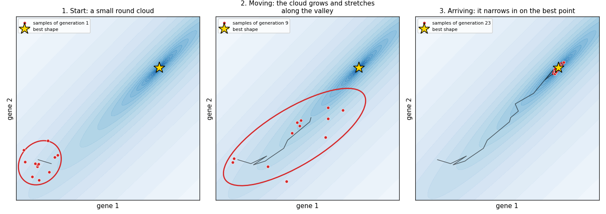
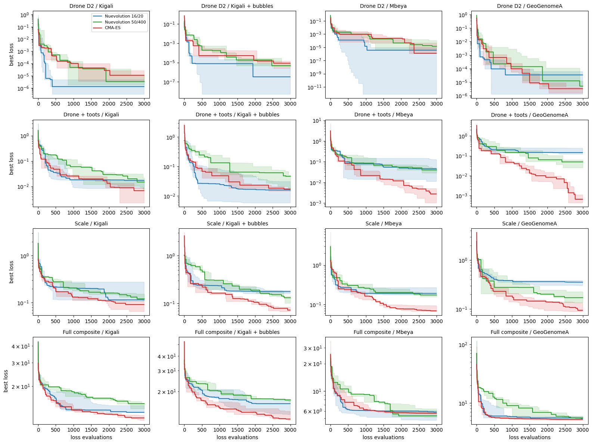
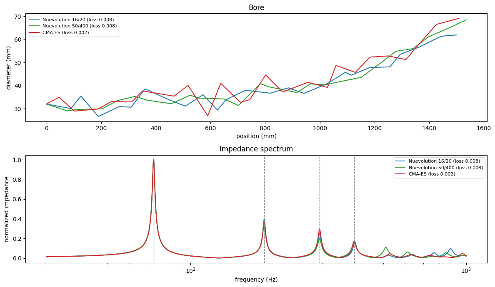

# CMA-ES: finding didgeridoo shapes with fewer simulations

DidgeLab designs didgeridoos by search. You describe what you want to hear, for example a drone on D and toots on F#, D and G. DidgeLab then tries thousands of bore shapes, simulates the sound of each one and keeps the ones that come closest. Every try costs one acoustical simulation, so the fewer tries an optimizer needs, the faster you get a good didgeridoo.

Until now DidgeLab had one optimizer, a genetic algorithm called `Nuevolution`. It now has a second one, **CMA-ES**. In our benchmark CMA-ES found the better didgeridoo in two thirds of all runs, and it reached the result of the genetic algorithm with 1.5 to 4.5 times fewer simulations.

## How a shape is searched

In DidgeLab a bore shape is described by a list of numbers between 0 and 1, the *genome*. For the default Kigali shape these are 49 numbers: the length, the bell diameter, how the bore widens and small bumps along the way. A *loss function* says how far the sound of a shape is from what you want. The optimizer looks for the genome with the smallest loss.

The **genetic algorithm** works like breeding. It keeps a population of good shapes and creates new ones from them: it changes some numbers at random (mutation) or mixes the numbers of two parents (crossover). The best new shapes stay, the others are dropped. This works, but it is blind. The mutations always have the same size, and the algorithm never learns *which* changes tend to help.

## What CMA-ES does differently

CMA-ES (Covariance Matrix Adaptation Evolution Strategy) was introduced by Nikolaus Hansen and Andreas Ostermeier in [Completely Derandomized Self-Adaptation in Evolution Strategies](https://doi.org/10.1162/106365601750190398) (Evolutionary Computation, 2001) and is one of the most widely used methods for optimization problems without gradients. A readable introduction is Hansen's tutorial [The CMA Evolution Strategy: A Tutorial](https://arxiv.org/abs/1604.00772); the [Wikipedia article](https://en.wikipedia.org/wiki/CMA-ES) gives a shorter overview.

CMA-ES does not keep a population of individual shapes. It keeps a *cloud* of possible shapes, a probability distribution around the shape it currently thinks is best. Every generation it does three things:

1. It draws a handful of shapes from the cloud and simulates them.
2. It moves the centre of the cloud towards the best of them.
3. It changes the size and the form of the cloud. If successful steps keep pointing in the same direction, the cloud grows and stretches in that direction. If they start to jump back and forth, the cloud is close to the goal and shrinks.



The picture shows this for a made-up problem with only two genes. The darker the blue, the lower the loss. The good shapes lie in a narrow diagonal valley: the two genes only give a good result if they change *together*. A genetic algorithm that changes one gene at a time keeps falling out of such a valley. CMA-ES learns the direction of the valley and stretches its cloud along it (middle). Near the goal it contracts and lands exactly on the best point (right).

Didgeridoos are full of such valleys. If you make the tube longer, all resonances go down. To keep the drone in tune, the bore has to become narrower or the bell wider at the same time. Hitting four resonances at once needs many genes to change in a coordinated way. This is the kind of problem CMA-ES was made for.

## The experiment

We wrote a benchmark notebook that lets both optimizers solve the same tasks: [optimizer_benchmark.ipynb](https://github.com/Didgitaldoo/didge-lab/blob/main/doc/examples/optimizer_benchmark.ipynb). It combines

* **four shapes**: the Kigali shape (49 genes), the Kigali shape with two bubbles (55 genes), the Mbeya shape (17 genes) and a simple shape of eight free segments (17 genes),
* **four targets**: a drone on D2 only; the drone plus three toots (F#3, D4, G4); drone and toots plus all resonances pulled towards D minor pentatonic; and the full set of eleven loss components, from tuning and peak height to Q factor and harmonic series,
* **three optimizers**: the genetic algorithm with a small population (16 new shapes per generation, 20 kept), the genetic algorithm with the settings of [DidgeLab online](/2026/05/27/didgelab-online.html) (50 new shapes per generation, 400 kept), and CMA-ES with 16 shapes per generation.

Every optimizer gets exactly **3000 simulations** per run, and every combination runs with three different random seeds. That makes 144 runs and about 430,000 simulations. The notebook counts the simulations itself, so no optimizer gets a hidden advantage.

## Results

CMA-ES had the best result in **33 of 48** comparisons. The small genetic algorithm won 9, the configuration of the web app 6.



Each panel shows how the best loss found so far goes down with the number of simulations. Red is CMA-ES, blue and green are the two genetic algorithms. The line is the median over the three seeds, the shaded band the range. Lower is better, and the scale is logarithmic.

* **Drone only (first row):** this is easy. All three optimizers find a drone that is off by far less than 0.1 cent. The differences you see in the plot are numerical noise, nobody could hear them.
* **Drone and toots (second row):** here CMA-ES pulls away. Its final loss is 2.4 to 60 times lower, on the two compact shapes even 13 and 60 times. Only on the Kigali shape with bubbles is the small genetic algorithm as good.
* **Scale (third row):** CMA-ES ends 1.5 to 2.2 times lower on every shape.
* **All eleven components (last row):** CMA-ES is 6 to 19 percent better on three of the four shapes. On the Mbeya shape all three end up at the same loss.

The second way to read the plots is from right to left: how many simulations does CMA-ES need to reach the final result of the better genetic algorithm? Wherever it gets there, it needs **650 to 1950 instead of 3000** simulations, that is **1.5 to 4.5 times fewer**.

Two more observations:

* **CMA-ES is more reliable.** Its bands are narrower on most panels, so the result depends less on luck. With the genetic algorithm two runs of the same task can end far apart.
* **CMA-ES is not always faster at the start.** In the first few hundred simulations the small genetic algorithm is sometimes ahead, because it greedily exploits its best shapes. CMA-ES first has to learn the form of the problem and then overtakes.

The setting of the web app (50/400) did worst. With 3000 simulations it only gets through 60 generations, and managing 400 shapes per generation also costs time: 15.5 seconds per run, compared with 3.5 seconds for CMA-ES with the same number of simulations.

## What the difference sounds like

The next picture shows the best bore of each optimizer for the task *drone and toots* on the Kigali shape, with its impedance spectrum. The dashed lines are the four target frequencies.



All three bores look similar and all three hit the targets roughly. The difference is in the details: added up over the four peaks (with the drone counted twice), the CMA-ES bore is off by about 1 cent, the bores of the genetic algorithms by about 5 cent.

## Faster simulations, too

The benchmark profits from a second improvement. Each loss evaluation in DidgeLab has become about six times faster. The simulation now looks for the peaks on a coarse frequency grid and then measures each peak precisely, instead of simulating the whole spectrum finely, and the inner loop of the simulation computes fewer expensive math functions. On top of that the peak frequencies are now accurate to about 0.1 cent, where the old grid was off by up to 2.5 cent. Together with CMA-ES, reaching the same result now takes roughly 3 to 10 times less computing time than before.

## How to use it

CMA-ES can be used wherever you used `Nuevolution` before:

```python
import numpy as np
from didgelab import CMAES, CompositeTairuaLoss, FrequencyTuningLoss, KigaliShape

loss = CompositeTairuaLoss()
targets = np.array([73.4, 185.0, 293.7, 392.0])  # D2, F#3, D4, G4
loss.add_component("freq", FrequencyTuningLoss(np.log2(targets), np.full(4, -1.0), [2.0, 1.0, 1.0, 0.5]))

evo = CMAES(loss, KigaliShape(), num_generations=200, population_size=16, sigma0=0.3)
population = evo.evolve()
best_geo = population[0].genome2geo()
```

`population_size` is the number of shapes per generation, and `sigma0` the initial size of the cloud. 16 and 0.3 are good defaults when you start from scratch. To improve a didgeridoo you already have, start from its genome with `start_from_father=True` and a small cloud, for example `sigma0=0.05`.

The web version, DidgeLab online, still uses the genetic algorithm. Given these results, switching it to CMA-ES is the obvious next step.

If you want to dig deeper or run the benchmark with your own targets and shapes, open the [benchmark notebook](https://github.com/Didgitaldoo/didge-lab/blob/main/doc/examples/optimizer_benchmark.ipynb). The mathematical details of CMA-ES are explained in Nikolaus Hansen's tutorial [The CMA Evolution Strategy](https://arxiv.org/abs/1604.00772).
