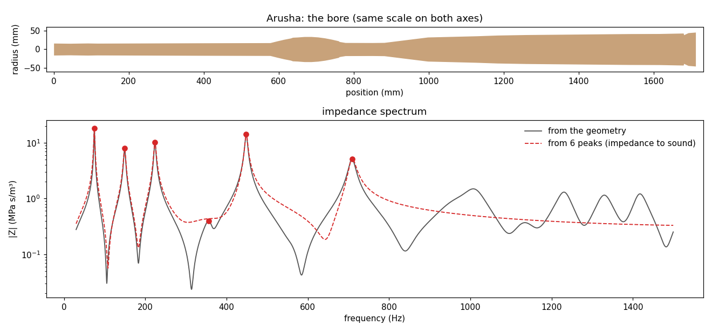

# Hearing a didgeridoo before it exists

Until now DidgeLab could tell you *which notes* a didgeridoo will play. It computes the impedance spectrum of a bore, and its peaks are the drone and the toots. But a list of peaks is not a sound. Two didgeridoos with the same drone can sound completely different: one dark and soft, the other bright and buzzy.

DidgeLab now has a **synthesizer**. It turns a didgeridoo into sound before anybody has cut a single piece of wood. There are two ways in:

* **Geometry to sound**: you give the shape of the bore, and DidgeLab plays it.
* **Impedance to sound**: you give only the acoustic target, a few resonance peaks, and DidgeLab plays a didgeridoo that has exactly these peaks.

Below you can hear both, next to recordings of the real instruments.

## How a computer plays a didgeridoo

A real didgeridoo sound is made by three things working together:

1. **The lips** buzz like a valve and push short puffs of air into the tube. They lock onto a resonance of the bore: on the first one for the drone, on a higher one for a toot.
2. **The bore** decides which frequencies are amplified. Every peak of the impedance spectrum is a resonance. How strongly each overtone of the drone comes out depends on whether it falls on a resonance or between two of them.
3. **The mouth and the vocal tract** of the player work like a second filter. Moving the tongue from back to front moves a bright formant through the sound. This is the "wah" or "ee-oo" you hear in every groove.

The synthesizer models all three with physics: the bore with the same transmission-line model that DidgeLab uses for its simulations, the lips as a beating valve, and the vocal tract as a chain of short tubes whose shape follows the tongue, the jaw and the glottis. On top of that it knows playing techniques like tongue stops (*di*, *ga*, *ti*, *ka*), toots, trills, vocalisation and circular breathing, and it can play little songs written in a simple text format.

If you want all the details, the [synthesizer article](https://github.com/Didgitaldoo/didge-lab/blob/main/doc/synthesizer.md) explains the physics step by step, and the notebook [geometry to sound](https://github.com/Didgitaldoo/didge-lab/blob/main/doc/examples/geometry_to_sound.ipynb) lets you try it yourself.

## Two ways in: geometry and impedance

**Geometry to sound** starts from the real bore. DidgeLab computes not only the impedance but everything the synthesizer needs: how the sound travels from the mouthpiece to the bell, and how strongly each frequency is radiated. This is the most realistic way.

**Impedance to sound** starts from much less: a list of peaks, each with a frequency, a height and a width. This is exactly what you define as the *acoustic target* when you set up an optimization in DidgeLab: "a drone on D, a toot on A, …". There is no bore yet, so DidgeLab builds a stand-in: it adds up one resonance for each peak. The notes come out exactly right, but everything the target does not say has to be guessed, above all the frequencies above the last peak. The [impedance to sound notebook](https://github.com/Didgitaldoo/didge-lab/blob/main/doc/examples/impedance_to_sound.ipynb) shows how this works and how accurate it is.

### Why only six peaks?

A real didgeridoo has many more resonances: the Arusha bore has 30 below 3 kHz. So why do the examples below use only the first six?

Because an acoustic target never lists all of them. When you plan a didgeridoo you think about the notes you can play: the drone and two or three toots, maybe one or two more peaks to make the sound stronger or weaker. Nobody specifies the 15th resonance. In DidgeLab's optimizer, too, a target typically has a handful of peaks. With six peaks the examples play exactly what such a target describes, and you hear what impedance to sound gives you *before* a bore exists, including what it cannot know.

The six peaks come from the measured bore, so they are a target that can certainly be built. That makes the comparison fair: the only difference between "geometry" and "impedance" is how much the synthesizer knows about the instrument. And giving it more peaks does not help: with all peaks up to 3 kHz the result is not closer to the recordings (see the measurement below).



The picture shows the difference for the Arusha didgeridoo. Up to about 550 Hz the six peaks (red) describe the instrument perfectly. Above that, the real bore (grey) has more resonances, but the six peaks do not know about them, so the red curve just fades out. These higher resonances shape the brightness of the sound.

## Listen: original, geometry and impedance

For five didgeridoos of the [Didge Archive](/2026/10/28/didge-archive.html) you can compare three versions:

* **Original**: the recording of the real instrument from the archive.
* **Geometry → sound**: the synthesizer plays the measured bore.
* **Impedance → sound**: the synthesizer plays only the first six impedance peaks of the same bore.

All examples are a plain, neutral drone, so this is a direct comparison (the original recordings are a bit shorter).

<style>
  .sound-examples { overflow-x: auto; }
  .sound-examples table { width: 100%; }
  .sound-examples audio { width: 100%; min-width: 150px; height: 36px; }
</style>
<div class="sound-examples">
<table>
  <thead>
    <tr><th>Didgeridoo</th><th>Original</th><th>Geometry → sound</th><th>Impedance → sound</th></tr>
  </thead>
  <tbody>


    <tr>
      <td><strong>{{ parts[1] }}</strong></td>
      <td><audio controls preload="none" src="/assets/audio/geometry_impedance_sound/{{ s }}-drone-original.mp3"></audio></td>
      <td><audio controls preload="none" src="/assets/audio/geometry_impedance_sound/{{ s }}-drone-geometry.mp3"></audio></td>
      <td><audio controls preload="none" src="/assets/audio/geometry_impedance_sound/{{ s }}-drone-impedance.mp3"></audio></td>
    </tr>

  </tbody>
</table>
</div>

What you will hear: all three versions of one instrument play the **same drone**. DidgeLab predicts the pitch of the drone within about 18 cents of the recordings. The differences are in the **colour** of the sound. The synthesized versions are cleaner than the recordings: there is no microphone or room noise, and much less breath noise than from a real player.

## Which one sounds more like the real didgeridoo?

Listening is subjective, so we also measured it. The overtones of a drone have a typical pattern of loud and quiet ones, a kind of fingerprint of the instrument. We compared the strengths of the first ten overtones of each neutral recording with the synthesized drone. Volume and the overall tilt of the spectrum were evened out first, because they depend on the microphone. On all nine instruments of the archive, the result is:

| | average difference to the recording |
|---|---|
| geometry → sound | **5.5 dB** |
| impedance → sound, 6 peaks | 7.9 dB |
| impedance → sound, all peaks up to 3 kHz | 8.6 dB |

Compared with the six-peak version, geometry to sound came closer for eight of the nine instruments. This is no surprise: the bore contains everything, the peaks only part of it. Even with *all* peaks up to 3 kHz, impedance to sound does not catch up. A bore is more than its peaks: how the sound gets from the mouthpiece to the bell depends on the shape between the peaks as well. The [comparison with the Didge Archive](https://github.com/Didgitaldoo/didge-lab/blob/main/doc/archive_comparison.md) describes how the synthesizer was checked against the recordings in detail.

## Why two ways, then?

Because they answer different questions.

**Geometry to sound is for a didgeridoo you have.** You designed a bore, maybe in the [Sketch](/sketch.html) or as the result of an optimization, and want to know how it sounds before you build it. Use the geometry: it gives the best result.

**Impedance to sound is for a didgeridoo you want.** Before an optimization starts there is no bore at all, only the acoustic target: which drone, which toots, how strong. Impedance to sound lets you **listen to the target itself**. Does a toot at a major third sound good with this drone? Do you want the second toot louder? You can try this in seconds, change the target and listen again, and only then start the optimization, which takes much longer. The optimizer then searches for a real bore that hits the target, and that bore can be played with geometry to sound.

Impedance to sound also helps with a reality check. Not every target can be built: two resonances cannot sit right next to each other, for example. DidgeLab can fit a simple bore to the target peaks in a few seconds ([geometry fit notebook](https://github.com/Didgitaldoo/didge-lab/blob/main/doc/examples/geometry_fit.ipynb)). If no bore hits the target, the target is probably not realistic.

## Try it

The synthesizer is part of DidgeLab (`didgelab.synth`):

```python
from didgelab.synth import render_song_loop, render_song_loop_from_peaks

# geometry to sound: a bore as [[position_mm, diameter_mm], ...]
audio, fs = render_song_loop([[0, 32], [800, 34], [1450, 75]], "tiki-du")

# impedance to sound: peaks as (frequency in Hz, impedance in Pa s/m³, Q)
target = [(73.4, 2.0e7, 20), (196.0, 9e6, 25), (311.1, 5e6, 30), (440.0, 3e6, 35)]
audio, fs = render_song_loop_from_peaks(target, "tiki-du")
```

More to read:

* [The synthesizer article](https://github.com/Didgitaldoo/didge-lab/blob/main/doc/synthesizer.md): the physics behind the sound, the calibration on the Didge Archive and its limits.
* [Geometry to sound](https://github.com/Didgitaldoo/didge-lab/blob/main/doc/examples/geometry_to_sound.ipynb) and [impedance to sound](https://github.com/Didgitaldoo/didge-lab/blob/main/doc/examples/impedance_to_sound.ipynb): notebooks with an introduction, the maths and examples to run.
* [The song format](https://github.com/Didgitaldoo/didge-lab/blob/main/doc/song_format.md): how to write your own grooves.
* [Comparison with the Didge Archive](https://github.com/Didgitaldoo/didge-lab/blob/main/doc/archive_comparison.md): how realistic the synthesizer is.

The sound examples on this page were made with [this script](https://github.com/Didgitaldoo/didgitaldoo.github.io/blob/main/scripts/sound_examples/make_sound_examples.py).
