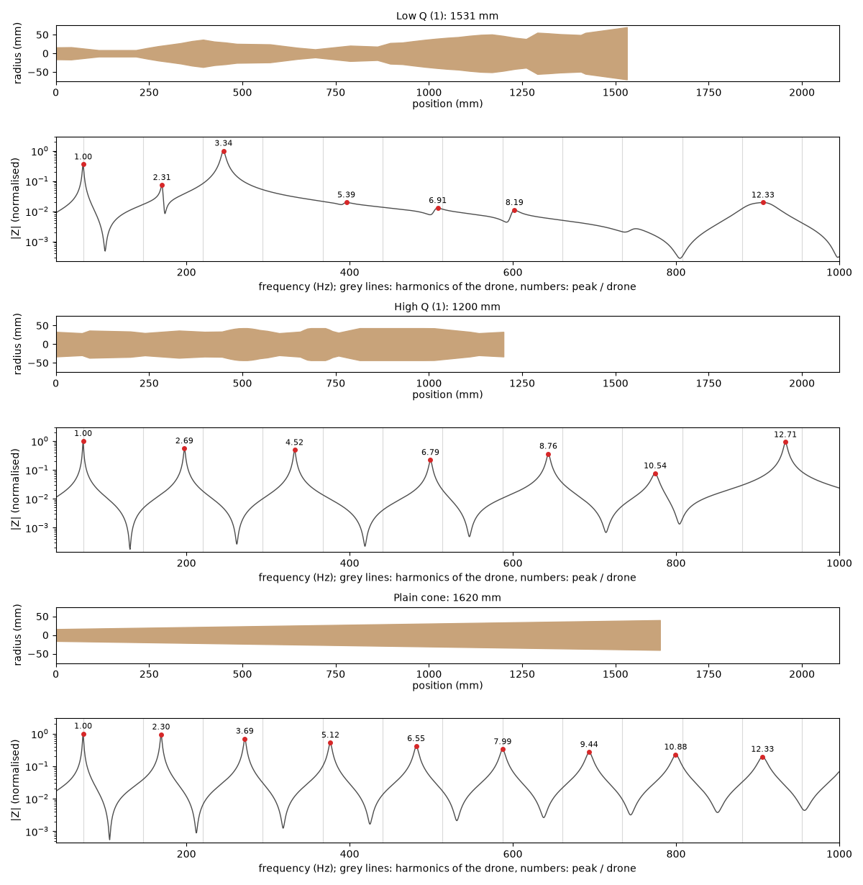
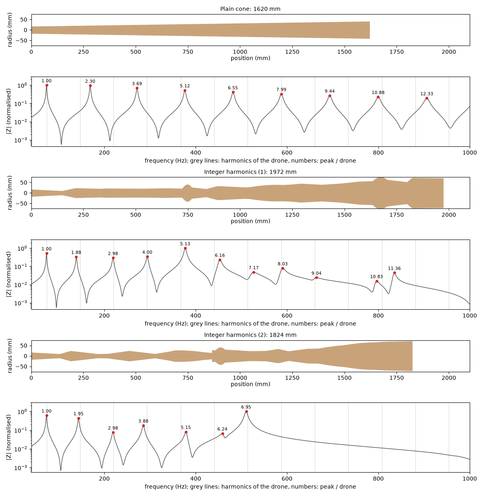
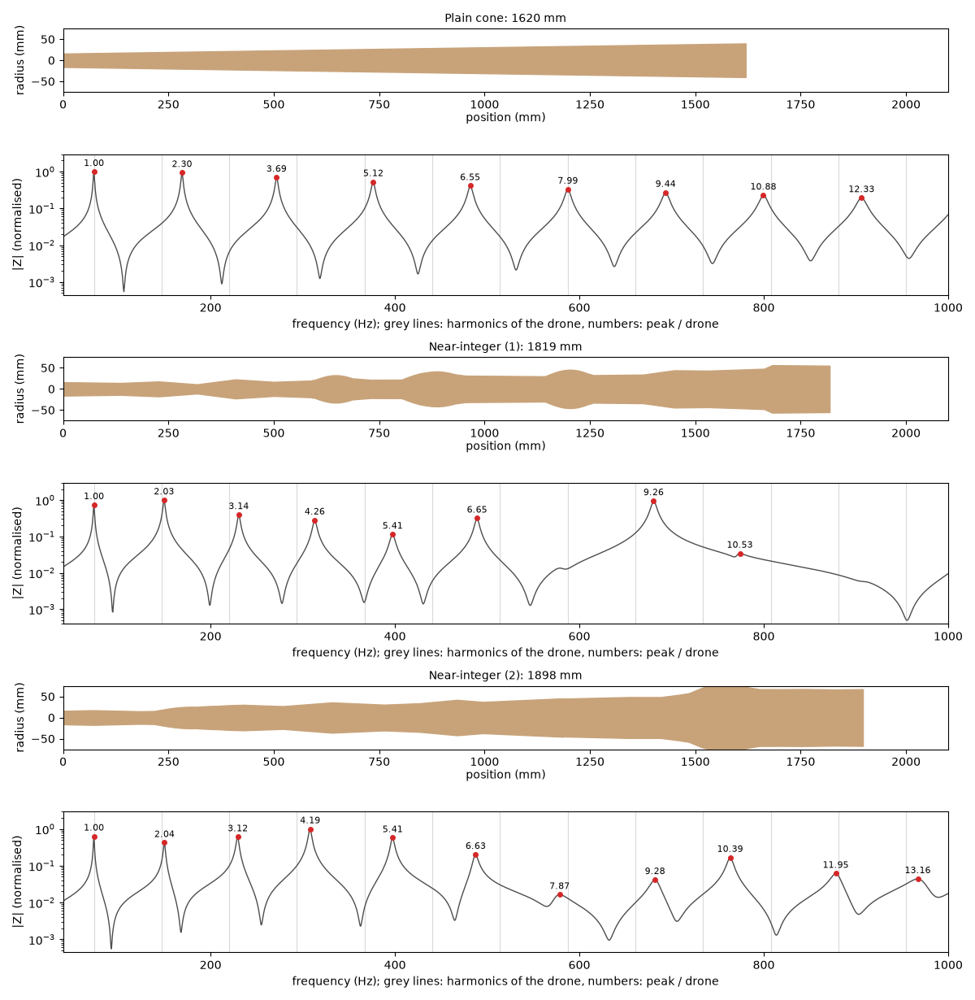
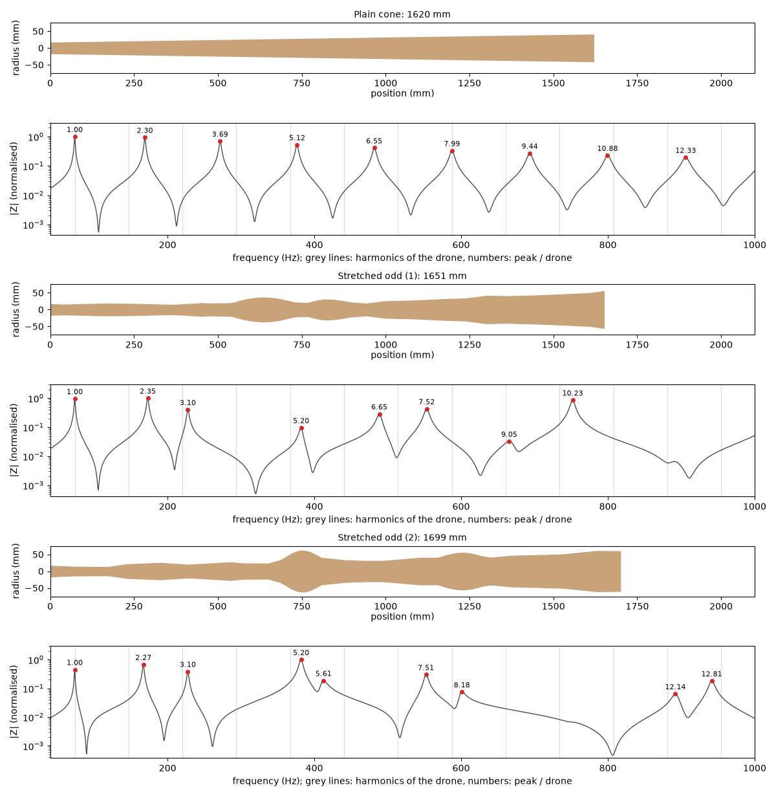
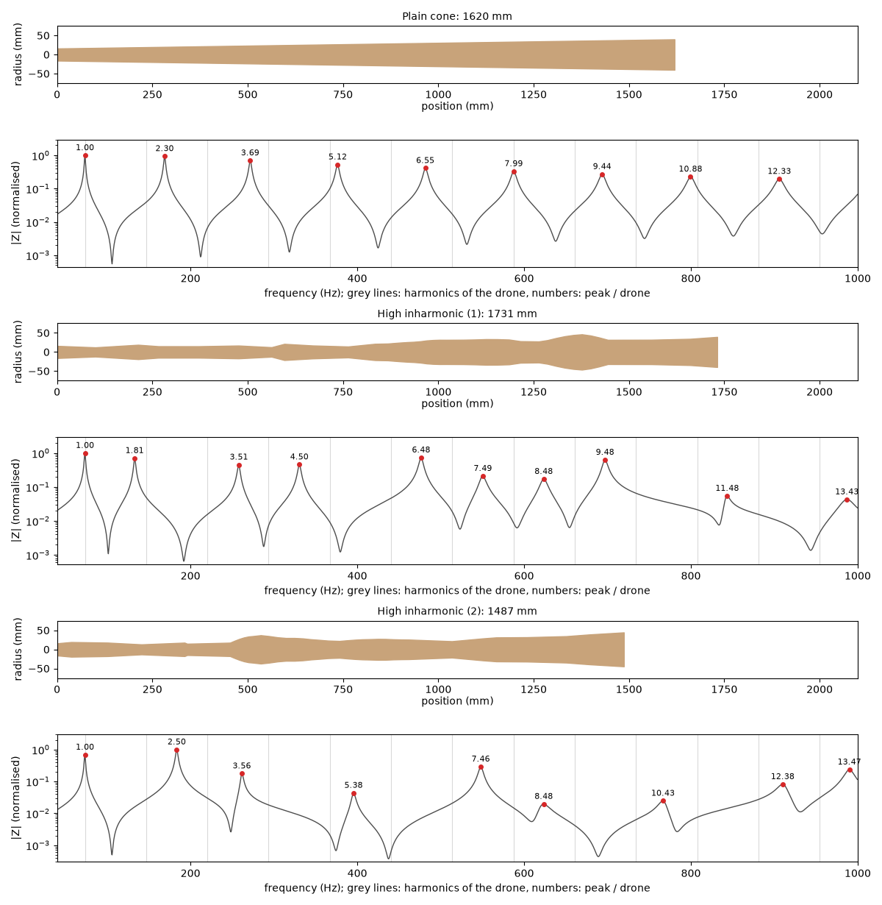
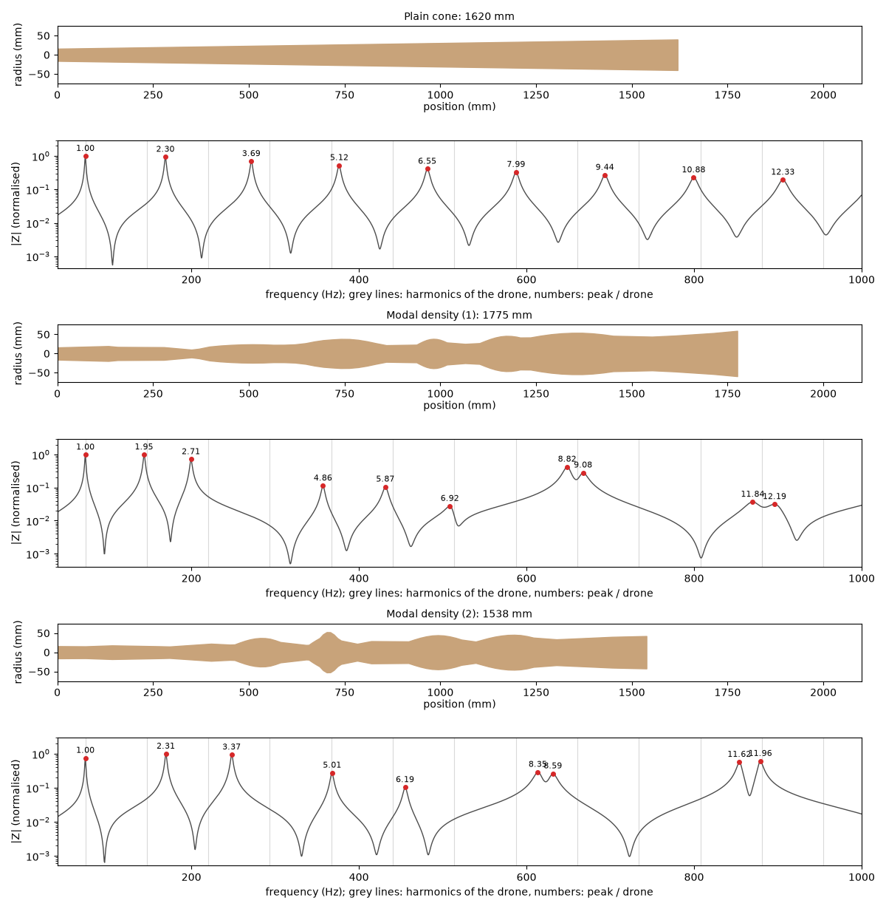
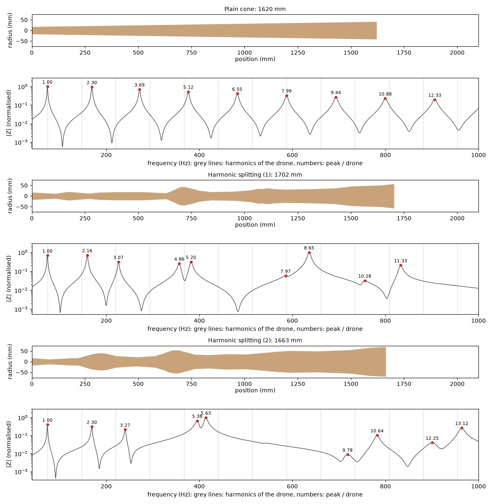

# Seven sound effects a didgeridoo can be evolved for

Most of the time DidgeLab is used to *tune* a didgeridoo: a drone on D, toots on F# and A. But two didgeridoos with the same notes can sound very different. One has a full, locked drone, the other a hollow, nasal one, a third seems to shimmer. These differences come from the bore too, and DidgeLab has loss functions for them.

We picked seven of these effects, let DidgeLab evolve ten didgeridoos for each, and played every one of them with the [DidgeLab synthesizer](/2026/10/31/geometry-and-impedance-to-sound.html). This post explains what each effect does acoustically, shows the bores and their impedance spectra and lets you listen.

**Contents**

* [Methods](#methods)
* [1. Q factor: sharp or broad resonances](#1-q-factor-sharp-or-broad-resonances)
* [2. Integer harmonics: a fully locked drone](#2-integer-harmonics-a-fully-locked-drone)
* [3. Near-integer: stretched harmonics](#3-near-integer-stretched-harmonics)
* [4. Stretched odd harmonics: the hollow clarinet sound](#4-stretched-odd-harmonics-the-hollow-clarinet-sound)
* [5. High inharmonicity: resonances between the harmonics](#5-high-inharmonicity-resonances-between-the-harmonics)
* [6. Modal density: the shimmer](#6-modal-density-the-shimmer)
* [7. Harmonic splitting: one resonance becomes two](#7-harmonic-splitting-one-resonance-becomes-two)
* [Summary](#summary)

## Methods

### A drone, its harmonics and the resonances of the bore

To understand the effects you need two series of frequencies.

**The harmonics of the drone.** The lips of the player open and close once per period of the drone. This puff of air is not a pure sine wave, so the drone contains all whole-number multiples of its frequency: a drone on D2 at 73.4 Hz also has energy at 146.8 Hz (2 ×), 220.3 Hz (3 ×), 293.7 Hz (4 ×) and so on. These are the *harmonics* or *overtones*. They are always exact multiples, because the lips repeat exactly the same movement every period.

**The resonances of the bore.** The tube itself amplifies some frequencies and damps others. DidgeLab computes this as the *impedance spectrum*; every peak in it is a resonance. The first peak is the drone. The higher peaks are where the toots are played, and they are usually *not* at whole-number multiples. For a plain cone they lie at about 1, 2.3, 3.7, 5.1, 6.6 times the drone.

The colour of the drone comes from how these two series fit together. A harmonic that falls on a resonance is amplified and comes out loud. A harmonic that falls between two resonances is weak. The bore cannot add frequencies to the drone that are not harmonics, it can only decide **how loud each harmonic is**. All seven effects below are different ways of arranging the resonances relative to the harmonics.

The figures in this post all look the same. For every didgeridoo, the bore is on top, drawn at true scale with the mouthpiece at 0 mm. Below it is its impedance spectrum. The grey vertical lines are the harmonics of the drone, the red dots are the resonances, and the number above each dot is its frequency divided by the drone. A resonance that sits on a grey line supports a harmonic.

### How the examples were made

For every effect, DidgeLab evolved a didgeridoo with the Kigali shape (1200 to 2300 mm long, bell up to 140 mm) and a loss function with two parts:

* the **drone** must be D2 (73.4 Hz). This part is weighted so strongly that all instruments stay in D, most of them within a few cents;
* the **effect**: one of the loss components described below.

Each effect was evolved **ten times** with different random seeds, 400 generations each, so we can see what the optimizer reliably finds and what is luck. The table below each effect lets you listen to three of them; the figure shows the first two. As a reference, every effect is compared with a **plain cone** in D: 1620 mm long, 32 mm at the mouthpiece, 80 mm at the bell.

Every bore plays three short pieces:

* a plain **drone** ("uh"): the colour of the bore itself;
* a **wa-wa** drone: the tongue moves between "oo" and "ee". This moves a bright formant up and down through the harmonics, so you can hear which of them are loud;
* a **groove** of "dong-tiki" and "ritititi".

We left out toots on purpose: the synthesizer does not play them convincingly yet. All clips are normalised to the same loudness, so you hear differences in colour, not in volume. Like all synthesized sounds, they show what the model predicts, not how a built instrument will sound. The real wood, the walls and the player add a lot.

The evolutions and the sound samples were made with [one notebook per effect](https://github.com/jnehring/didgelab-experiments/tree/main/evolution_targets), and the figures and audio files on this page with [this script](https://github.com/Didgitaldoo/didgitaldoo.github.io/blob/main/scripts/evolution_targets/make_evolution_target_examples.py).

/assets/audio/evolution_targets

## 1. Q factor: sharp or broad resonances

The **Q factor** of a resonance says how sharp its peak is: the centre frequency divided by the width of the peak (measured 3 dB below the top). A high Q means a tall, narrow peak. A low Q means a broad, flat one. `QFactorLoss` pulls the average Q of all resonances below 1 kHz towards a target.

What to expect:

* **High Q:** a harmonic that falls on a sharp resonance is strongly amplified, one that misses it gets almost nothing. The sound is loud, bright and piercing, but also less forgiving: toots have to be hit precisely.
* **Low Q:** broad resonances support a wider range of frequencies. The sound is softer, darker and woodier, and the wa-wa sweeps more smoothly.

We evolved towards Q = 20 and Q = 250. Both are out of reach on purpose, so the optimizer keeps pushing. The cone has an average Q of 98. The low-Q bores ended at an average Q of 37 to 49, the high-Q bores at 123 to 153.

The figure shows Low Q (1) and High Q (1). The high-Q bore is short and narrow (1200 mm, which is the shortest length allowed) with tall, sharp peaks. The low-Q bore found a trick: above 300 Hz its resonances are almost gone, only small, broad bumps are left. These weak peaks bring the average Q down. So "low Q" here also means "few strong resonances", and you will hear a darker drone with weak overtones.

<table>
  <thead><tr><th>Bore</th><th>Drone</th><th>Wa-wa</th><th>Groove</th></tr></thead>
  <tbody>


    <tr>
      <td><strong>{{ p[1] }}</strong></td>
      <td><audio controls preload="none" src="{{ audio }}/{{ p[0] }}-drone.mp3"></audio></td>
      <td><audio controls preload="none" src="{{ audio }}/{{ p[0] }}-wawa.mp3"></audio></td>
      <td><audio controls preload="none" src="{{ audio }}/{{ p[0] }}-groove.mp3"></audio></td>
    </tr>

  </tbody>
</table>

## 2. Integer harmonics: a fully locked drone

`IntegerHarmonicLoss` asks for every resonance to sit exactly on a harmonic of the drone: the second resonance at 2 ×, the third at 3 × and so on. Then *every* harmonic of the drone is supported by its own resonance.

A plain didgeridoo is far from this: the cone has its second resonance at 2.3 ×, between the 2nd and the 3rd harmonic. A bore with integer resonances should give a full, rich, "locked" drone with strong overtones, a bit like a brass instrument. It would also make every toot consonant with the drone, because every toot would be a harmonic of it.

$$
L_{int} = \frac{w}{600 N} \sum_{n=1}^{N} \left| 1200 \log_2 \frac{f_n}{n f_0} \right|
$$

This is the average distance of the resonances from the harmonics, in cents. The best run reached an average of **33 cents**, the worst 90 cents. The cone is at 400 cents.

Look at Integer harmonics (1): the resonances above the drone lie at 1.88, 2.98, 4.00, 5.13 and 6.16 times the drone, close to the grey lines. Above that it gets harder, and the peaks become weaker. All ten runs found long bores (1.8 to 2.1 m) with a wide bell, mostly the largest one allowed.

<table>
  <thead><tr><th>Bore</th><th>Drone</th><th>Wa-wa</th><th>Groove</th></tr></thead>
  <tbody>


    <tr>
      <td><strong>{{ p[1] }}</strong></td>
      <td><audio controls preload="none" src="{{ audio }}/{{ p[0] }}-drone.mp3"></audio></td>
      <td><audio controls preload="none" src="{{ audio }}/{{ p[0] }}-wawa.mp3"></audio></td>
      <td><audio controls preload="none" src="{{ audio }}/{{ p[0] }}-groove.mp3"></audio></td>
    </tr>

  </tbody>
</table>

## 3. Near-integer: stretched harmonics

`NearIntegerLoss` is the integer series with a twist. The resonances should lie a little *above* the harmonics, and more so the higher they are: resonance $n$ at $n \cdot f_0 \cdot s^{\,n-1}$. We used a stretch of $s = 1.02$, so the targets are 1, 2.04, 3.12, 4.24, 5.41, 6.63 times the drone.

This is the same pattern as in a piano string, whose overtones are slightly sharp because the steel is stiff. For the didgeridoo it means: the low harmonics are still well supported, but the higher ones fall more and more between the resonances. The drone should keep a strong base but sound a little wider and less locked than the integer bores.

This target was the easiest to hit. The resonances of the best bore, Near-integer (1), are on average only about 5 cents from the stretched targets. Again all ten runs ended with long bores and a wide bell, much like the integer bores.

<table>
  <thead><tr><th>Bore</th><th>Drone</th><th>Wa-wa</th><th>Groove</th></tr></thead>
  <tbody>


    <tr>
      <td><strong>{{ p[1] }}</strong></td>
      <td><audio controls preload="none" src="{{ audio }}/{{ p[0] }}-drone.mp3"></audio></td>
      <td><audio controls preload="none" src="{{ audio }}/{{ p[0] }}-wawa.mp3"></audio></td>
      <td><audio controls preload="none" src="{{ audio }}/{{ p[0] }}-groove.mp3"></audio></td>
    </tr>

  </tbody>
</table>

## 4. Stretched odd harmonics: the hollow clarinet sound

A cylinder that is closed at one end, like a clarinet, has resonances only at the **odd** multiples: 1, 3, 5, 7 times its lowest note. The even harmonics of the reed get no support, and this gives the clarinet its hollow, "square-wave" colour.

`StretchedOddLoss` asks for resonances near 1, 3.1 and 5.2 times the drone, odd and slightly stretched. Every one of the ten runs hit these three targets to within a cent: the 3rd and 5th harmonic of the drone are supported in all of them.

But look at what the loss does *not* ask for. Both bores still have a resonance at about 2.3 times the drone, between the 2nd and the 3rd harmonic, and more peaks above 5.2. The loss only rewards the odd targets, it does not punish other resonances. So these bores are "odd" in that the 3rd and 5th harmonics are strong, but they are not real clarinets. To get a truly hollow sound, the loss would also have to push the resonances away from 2 × and 4 ×.

<table>
  <thead><tr><th>Bore</th><th>Drone</th><th>Wa-wa</th><th>Groove</th></tr></thead>
  <tbody>


    <tr>
      <td><strong>{{ p[1] }}</strong></td>
      <td><audio controls preload="none" src="{{ audio }}/{{ p[0] }}-drone.mp3"></audio></td>
      <td><audio controls preload="none" src="{{ audio }}/{{ p[0] }}-wawa.mp3"></audio></td>
      <td><audio controls preload="none" src="{{ audio }}/{{ p[0] }}-groove.mp3"></audio></td>
    </tr>

  </tbody>
</table>

## 5. High inharmonicity: resonances between the harmonics

`HighInharmonicLoss` is the opposite of the integer loss. It pushes every resonance as far as possible *away* from the harmonics. The furthest a resonance can be is exactly halfway between two harmonics, at 2.5, 3.5, 4.5 times the drone.

$$
L_{inharm} = w \left( 0.5 - \frac{1}{N}\sum_{n} \left| \frac{f_n}{f_0} - \operatorname{round}\frac{f_n}{f_0} \right| \right)
$$

The optimizer did this remarkably well. In High inharmonic (1), seven of the resonances lie at x.5: 3.51, 4.50, 6.48, 7.49, 8.48, 9.48 and 11.48.

What does that do to the sound? Remember that the drone itself stays harmonic: the bore can only make harmonics loud or weak. Here almost no harmonic above the drone falls on a resonance, so the overtones should be weak and the drone thinner and less locked to the bore. Where this effect really bites is in the toots: every toot would sit a quarter tone or more away from any harmonic of the drone, which sounds dissonant and metallic. (These examples have no toots, see above.)

<table>
  <thead><tr><th>Bore</th><th>Drone</th><th>Wa-wa</th><th>Groove</th></tr></thead>
  <tbody>


    <tr>
      <td><strong>{{ p[1] }}</strong></td>
      <td><audio controls preload="none" src="{{ audio }}/{{ p[0] }}-drone.mp3"></audio></td>
      <td><audio controls preload="none" src="{{ audio }}/{{ p[0] }}-wawa.mp3"></audio></td>
      <td><audio controls preload="none" src="{{ audio }}/{{ p[0] }}-groove.mp3"></audio></td>
    </tr>

  </tbody>
</table>

## 6. Modal density: the shimmer

`ModalDensityLoss` rewards **pairs** of resonances that lie very close together, about 50 cents (a quarter tone) apart:

$$
L_{shimmer} = \frac{w}{1 + \sum_i e^{-(\Delta c_i - C)^2 / \sigma^2}}
$$

$\Delta c_i$ is the distance between two neighbouring resonances in cents, $C$ = 50 cents. Every pair at the right distance adds about 1 to the denominator, so one pair halves the loss, two pairs bring it to a third.

Two resonances this close behave like two strings tuned slightly apart. Whenever the sound changes, at an attack, a tongue movement or a change in the lips, both ring at once and beat against each other. And a harmonic that falls between them is supported from both sides, by a broad double peak. This is what the effect is named for: a shimmering, chorus-like movement in the overtones.

This target was hard. Seven of the ten runs found one pair, three found two. Both examples in the figure have two: at 8.8 and 9.1 times the drone and at 11.8 and 12.2 (Modal density (1)), at 8.4 and 8.6 and at 11.6 and 12.0 (Modal density (2)). The pairs are all high up, between 600 and 900 Hz. Listen to the wa-wa, where the formant of the tongue sweeps over them.

<table>
  <thead><tr><th>Bore</th><th>Drone</th><th>Wa-wa</th><th>Groove</th></tr></thead>
  <tbody>


    <tr>
      <td><strong>{{ p[1] }}</strong></td>
      <td><audio controls preload="none" src="{{ audio }}/{{ p[0] }}-drone.mp3"></audio></td>
      <td><audio controls preload="none" src="{{ audio }}/{{ p[0] }}-wawa.mp3"></audio></td>
      <td><audio controls preload="none" src="{{ audio }}/{{ p[0] }}-groove.mp3"></audio></td>
    </tr>

  </tbody>
</table>

## 7. Harmonic splitting: one resonance becomes two

`HarmonicSplittingLoss` is the targeted version of the shimmer. It asks for **one chosen resonance** to split into a doublet, two peaks less than a given distance apart. We chose the fourth resonance and a distance of 30 Hz. The idea is a gritty, buzzing colour in exactly one region of the spectrum, the region of one toot.

This loss is either 0 (split) or 1 (not split), with nothing in between. That gives the optimizer no hint which direction is better, so we let every run restart up to ten times until it found a split. All ten runs found one, within one to three attempts.

In Harmonic splitting (1) the doublet is at 4.86 and 5.20 times the drone, 357 and 382 Hz, and the 5th harmonic of the drone (367 Hz) sits right between the two peaks. In Harmonic splitting (2) the doublet lies at 5.38 and 5.63. Compared with the shimmer bores, the double peak here is low in the spectrum, where the drone has a lot of energy.

<table>
  <thead><tr><th>Bore</th><th>Drone</th><th>Wa-wa</th><th>Groove</th></tr></thead>
  <tbody>


    <tr>
      <td><strong>{{ p[1] }}</strong></td>
      <td><audio controls preload="none" src="{{ audio }}/{{ p[0] }}-drone.mp3"></audio></td>
      <td><audio controls preload="none" src="{{ audio }}/{{ p[0] }}-wawa.mp3"></audio></td>
      <td><audio controls preload="none" src="{{ audio }}/{{ p[0] }}-groove.mp3"></audio></td>
    </tr>

  </tbody>
</table>

## Summary

| Effect | What the bore does | Expected sound | How well it worked in 10 runs |
|---|---|---|---|
| High Q | sharp, tall resonances | loud, bright, piercing | average Q 123 to 153 (cone: 98) |
| Low Q | broad, weak resonances | soft, dark, woody | average Q 37 to 49, mostly by weakening the upper resonances |
| Integer harmonics | a resonance on every harmonic | full, locked, brassy | 33 to 90 cents off on average (cone: 400) |
| Near-integer | resonances slightly above the harmonics | strong base, wider top | best run about 5 cents from the stretched targets |
| Stretched odd | resonances at 1, 3.1, 5.2 × | hollow, clarinet-like | all runs hit the targets, but keep their even-ish resonances |
| High inharmonic | resonances halfway between harmonics | thin drone, dissonant toots | most resonances near x.5 in the best runs |
| Modal density | pairs of resonances 50 cents apart | shimmer, beating | two pairs in 3 runs, one pair in 7 |
| Harmonic splitting | one resonance split in two | buzz in one region | a split in every run, 1 to 3 attempts |

A few things we learned along the way:

* **The drone is always harmonic.** None of these bores can make the drone itself inharmonic or beating in a steady state. They decide which harmonics are loud. The effects are strongest where the sound changes: in attacks, tongue movements and toots.
* **The optimizer takes the shortest way to a low loss.** The low-Q bores made their resonances weak instead of broad, the odd bores kept resonances the loss did not forbid. A loss function gets exactly what it asks for, so effects often work best combined with other loss components, for example a minimum peak height.
* **Several effects lead to similar bores.** The integer and the near-integer bores are both long with a wide bell; the effects differ in details of the bore that you only see in the impedance spectrum.

## Try it yourself

All seven effects are available as acoustic targets on [didgelab.com](https://didgelab.com). You can combine them with your own tuning, for example a drone on D with a shimmer or a fully locked drone, and evolve your own didgeridoo.
